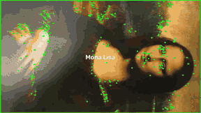
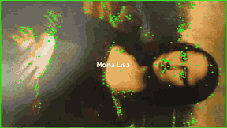
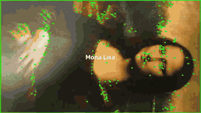
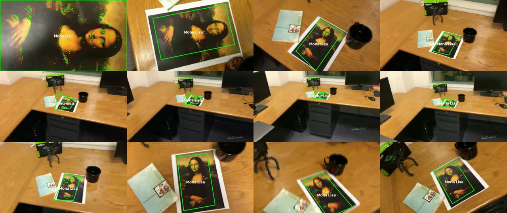
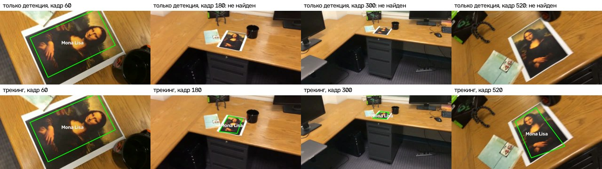
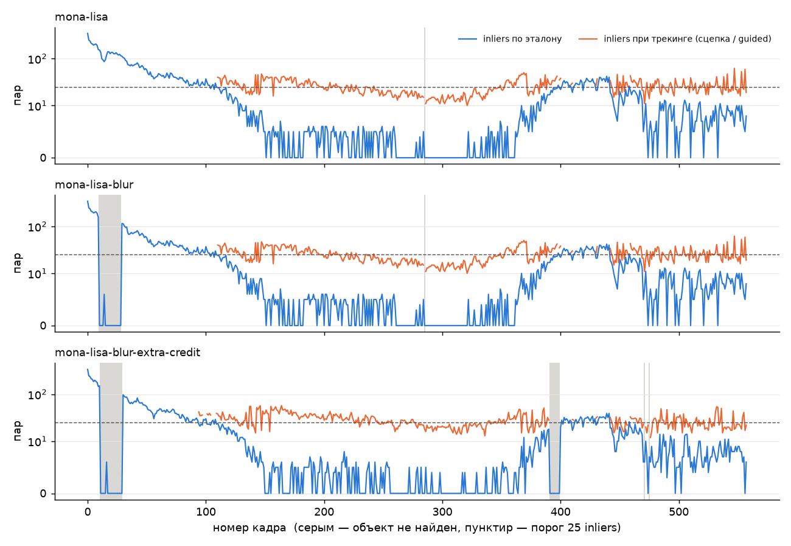
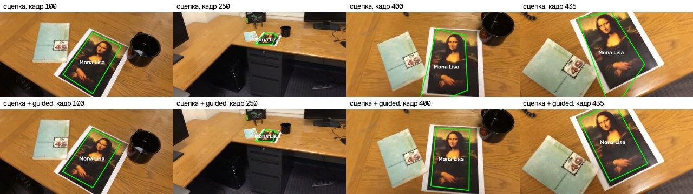

# Трекинг плоского объекта по ключевым точкам SIFT

Лабораторная работа 2 по дисциплине «Системы компьютерной обработки изображений».

Выполнил: Молодиченко Семен Андреевич, группа P3313.

Программа получает видео, первый кадр которого — крупное изображение объекта. На каждом кадре, где объект виден, вокруг него рисуется рамка с подписью. Объект плоский, поэтому его положение на кадре описывается гомографией, и рамка повторяет перспективу объекта, а не просто ограничивает его прямоугольником.

Поиск и сопоставление ключевых точек сделаны на SIFT. Прямого сопоставления с эталоном не хватает, когда объект уходит далеко, поэтому в программе две части:

- **детекция**: кадр сопоставляется с эталоном (первым кадром);
- **трекинг**: если связь с эталоном слабая, кадр сопоставляется с предыдущим кадром, а рамка затем уточняется по эталону (guided matching), чтобы ошибка не накапливалась.

| mona-lisa | mona-lisa-blur | mona-lisa-blur-extra-credit |
|---|---|---|
|  |  |  |

Видео с результатом в полном качестве: [mona-lisa.mp4](results/mona-lisa.mp4), [mona-lisa-blur.mp4](results/mona-lisa-blur.mp4), [mona-lisa-blur-extra-credit.mp4](results/mona-lisa-blur-extra-credit.mp4).

## 1. Теоретическая база

### Ключевые точки

Ключевая точка — это место изображения, которое можно надёжно найти снова на другом снимке той же сцены: угол, пятно, пересечение линий. Каждую точку описывает дескриптор, вектор признаков её окрестности. Если дескрипторы двух точек на разных снимках близки, скорее всего, это одна и та же точка объекта. Чтобы так работало при движении камеры, детектор и дескриптор должны быть устойчивы к сдвигу, повороту, изменению масштаба и освещения.

Точек много там, где много текстуры. На однотонных участках (белое поле листа, стол без узора) находить нечего, поэтому для трекинга выбирают объекты с богатой текстурой.

### SIFT

SIFT (Scale-Invariant Feature Transform) [1] ищет точки в пространстве масштабов. Изображение размывается гауссианами с растущим σ, и соседние уровни вычитаются друг из друга. Получается пирамида разностей гауссиан (DoG):

```
D(x, y, σ) = (G(x, y, kσ) − G(x, y, σ)) * I(x, y)
```

Дальше SIFT работает так.

1. **Пирамида.** Пирамида делится на октавы. В каждой октаве изображение вдвое меньше, чем в предыдущей. В OpenCV по умолчанию 3 уровня на октаву, начальное σ = 1.6, а исходное изображение перед построением пирамиды увеличивается вдвое [5].
2. **Экстремумы.** Ключевая точка — локальный максимум или минимум D среди 26 соседей: 8 на своём уровне и по 9 на двух соседних. Так точка получает не только координаты, но и свой масштаб.
3. **Отбраковка.** Положение точки уточняется интерполяцией. Точки с низким контрастом (в OpenCV порог `contrastThreshold = 0.04`) и точки на прямых краях (отношение главных кривизн больше 10) отбрасываются.
4. **Ориентация.** По гистограмме направлений градиента в окрестности точке назначается главное направление. Дескриптор считается в повёрнутой системе координат, поэтому он не зависит от поворота.
5. **Дескриптор.** Окрестность делится на 4×4 ячейки, в каждой строится гистограмма градиентов по 8 направлениям. Получается вектор из 4·4·8 = 128 чисел. Он нормируется, большие значения обрезаются, и вектор нормируется снова, чтобы ослабить влияние освещения.

Патент на SIFT истёк в 2020 году, и с версии OpenCV 4.4 детектор входит в основной модуль как `cv2.SIFT_create()` [5].

### Сопоставление и тест Лоу

Дескрипторы сравниваются по евклидову расстоянию. Для каждой точки эталона ищутся два ближайших дескриптора на кадре, d₁ ≤ d₂. Пара принимается, только если

```
d₁ < ratio · d₂
```

Это тест отношения Лоу [1]. Если ближайший сосед ненамного лучше второго, точка неоднозначна (повторяющийся узор, шум), и такую пару надёжнее выбросить. Лоу предложил порог 0.8, в примерах OpenCV используются 0.7–0.75 [4], в работе выбран 0.75.

Искать соседей можно полным перебором или приближённо, например в библиотеке FLANN [7]. FLANN строит рандомизированные KD-деревья, поэтому быстрее на больших наборах, но результат может меняться от запуска к запуску.

### Гомография

Все точки плоского объекта переносятся с одного снимка на другой одним и тем же проективным преобразованием, гомографией [3]. В однородных координатах:

```
[x']     [h11 h12 h13] [x]
[y'] ~   [h21 h22 h23] [y]
[1 ]     [h31 h32 h33] [1]

x' = (h11·x + h12·y + h13) / (h31·x + h32·y + h33)
y' = (h21·x + h22·y + h23) / (h31·x + h32·y + h33)
```

Матрица задана с точностью до множителя, поэтому у неё 8 степеней свободы. Каждая пара точек даёт два уравнения, и для оценки нужно минимум 4 пары. Когда гомография эталон → кадр найдена, через неё переносятся четыре угла эталона. Получается четырёхугольник, который совпадает с границами объекта с учётом перспективы.

### RANSAC

Среди пар после теста Лоу всё равно остаются ошибочные. Метод наименьших квадратов по всем парам испортился бы из-за них, поэтому гомография оценивается методом RANSAC [2]:

1. Случайно выбрать 4 пары и посчитать по ним гомографию.
2. Посчитать, сколько пар с ней согласно: ошибка репроекции `‖H·p − p'‖` меньше порога (в работе 5 пикселей). Это inliers.
3. Повторить много раз и оставить гипотезу с наибольшим числом inliers, затем уточнить её по всем inliers.

Число итераций N, нужное, чтобы с вероятностью p хотя бы раз выбрать четыре верные пары при доле верных пар w:

```
N = log(1 − p) / log(1 − w⁴)
```

При w = 0.5 и p = 0.99 это 72 итерации. Число inliers служит мерой уверенности: если согласных пар мало, объект на кадре, скорее всего, не найден.

### Детекция и трекинг

Детекция ищет объект на каждом кадре заново, по эталону. Ошибки не накапливаются, но объект теряется, когда его вид сильно отличается от эталона, например когда он далеко и по стороне в 10 раз меньше, чем на эталоне. При таком уменьшении мелкие детали, на которых держится большинство точек эталона, просто исчезают.

Трекинг использует то, что соседние кадры почти одинаковы. Если на кадре t−1 объект найден с гомографией H₍t−1₎, достаточно найти гомографию между кадрами t−1 и t и перемножить:

```
H_t = H_(t−1 → t) · H_(t−1)
```

Минус такой сцепки — дрейф: малые ошибки каждого шага перемножаются и со временем копятся, рамка понемногу уезжает. Классический способ с этим бороться — guided matching [3]. Сцепленная гомография служит прогнозом, точки эталона проецируются по ней на кадр, и пара для каждой ищется только рядом с прогнозом. Пространственное ограничение отсекает большинство ложных кандидатов, поэтому пар с эталоном находится намного больше, чем при поиске по всему кадру, и по ним можно снова оценить гомографию эталон → кадр напрямую.

## 2. Описание разработанной системы

### Структура проекта

```
lab2/
|-- tracker.py           # SiftTracker: детекция, сцепка, guided matching, отрисовка
|-- main.py              # CLI: трекинг одного видео, запись видео и CSV
|-- evaluate.py          # прогон всех видео, сводные таблицы, графики, GIF
|-- test_tracker.py      # тесты pytest на синтетике с известной гомографией
|-- requirements.txt
|-- data/                # тестовые видео
`-- results/             # видео с рамкой, CSV по кадрам, таблицы, графики
```

### Архитектура

```
        main.py (CLI)                    evaluate.py
        одно видео                 все видео, таблицы, графики
             |                                |
             +---------------+----------------+
                             |
                     track_video (main.py)
                чтение кадров, запись видео и CSV
                             |
                             v
                  tracker.py: SiftTracker
     +-----------+-----------+-----------+-------------+
     |           |           |           |             |
  _detect    _estimate    _guided     _accept       draw
   SIFT     BFMatcher +  поиск пар   проверка     рамка,
            тест Лоу +   у прогноза  рамки        подпись,
            RANSAC                                 точки
```

`SiftTracker` хранит эталон (точки и дескрипторы первого кадра) и состояние трекинга: точки последнего удачного кадра внутри рамки, их дескрипторы, гомографию этого кадра и число кадров подряд без объекта. Метод `process(frame)` возвращает `TrackResult`: найден ли объект, углы рамки, гомографию, источник оценки и статистику по парам.

### Обработка одного кадра

```
                          кадр t
                             |
                     SIFT: точки кадра
                             |
              [1] сопоставление с эталоном
                             |
                  inliers >= 25 ?  --да-->  рамка по эталону ("ref")
                             | нет
              есть удачный кадр в памяти?
                       | да           | нет
                       v              |
 [2] сопоставление с точками прошлой  |
     рамки, H_t = H_(t-1->t)·H_(t-1)  |
                       |              |
        inliers >= 10? --нет-------->+
                       | да           |
                       v              |
 [3] guided: точки эталона по прогнозу|
     H_t, пары в радиусе 25 px        |
     inliers >= 15 и сдвиг < 25 px?   |
       | да               | нет       |
       v                  v           v
   рамка "guided"    рамка "prev"   [4] эталон, inliers >= 10?
                                      | да          | нет
                                      v             v
                                 рамка "ref"   объект не найден
```

1. **Детекция по эталону.** SIFT находит точки кадра, `BFMatcher` ищет для каждой точки эталона двух ближайших соседей, тест Лоу оставляет однозначные пары, `cv2.findHomography(..., cv2.RANSAC, 5.0)` оценивает гомографию. Если inliers не меньше 25, связь с эталоном сильная, и рамка строится сразу.
2. **Сцепка.** Иначе кадр сопоставляется с последним удачным кадром, точнее только с точками внутри найденной там рамки. Так фон не мешает, а объект в соседних кадрах выглядит почти одинаково, и пар много даже тогда, когда он далеко. Гомография «прошлый кадр → кадр» умножается на гомографию прошлого кадра.
3. **Guided matching.** Точки эталона проецируются на кадр по сцепленной гомографии. Для каждой точки эталона кандидатами считаются только точки кадра в радиусе 25 пикселей от прогноза. Тест Лоу применяется среди этих кандидатов, затем RANSAC. Уточнение принимается, если inliers не меньше 15 и рамка сдвинулась относительно прогноза в среднем меньше чем на радиус поиска: раз пары искались рядом с прогнозом, честное уточнение дальше уехать не может. Принятое уточнение снова привязывает рамку к эталону.
4. **Слабая детекция.** Если трекинга нет (объект ещё не найден или давно потерян) или он не сработал, принимается детекция по эталону с порогом 10 inliers.

Если объект на кадре не найден, последний удачный кадр помнится ещё 15 кадров (`max_lost`), и трекинг пытается связаться с ним. Один смазанный кадр не обрывает трекинг: камера за полсекунды уходит недалеко, и сопоставление с кадром, который был несколько кадров назад, ещё работает.

### Проверка рамки

Гомография по малому числу точек может получиться вырожденной: рамка выворачивается, перекручивается или схлопывается. Такая рамка отбрасывается (`_plausible`), если:

- четырёхугольник невыпуклый (самопересечение);
- порядок обхода углов поменялся (отражение), это проверяется по знаку ориентированной площади;
- площадь меньше 0.2% кадра;
- самая длинная сторона больше самой короткой в 10 раз и более.

### Эталон и рамка

Эталон — весь первый кадр. Рамка на следующих кадрах — это образ границ первого кадра. Если на первом кадре объект занимает кадр не полностью или, наоборот, обрезан (как в тестовых видео: на первом кадре видна только центральная часть картины), рамка охватывает ровно ту часть объекта, которая была видна на первом кадре.

### Параметры

| Параметр | Значение | Смысл |
|---|---|---|
| `ratio` | 0.75 | порог теста Лоу |
| `ransac_thresh` | 5.0 px | порог ошибки репроекции в RANSAC |
| `min_matches`, `min_inliers` | 10 | минимум пар и inliers, чтобы принять гомографию |
| `strong_inliers` | 25 | столько inliers по эталону достаточно без трекинга |
| `guided_radius` | 25 px | радиус поиска пар вокруг прогноза |
| `guided_inliers` | 15 | минимум inliers для уточнения по эталону |
| `max_lost` | 15 кадров | сколько помнить последний удачный кадр |
| `min_area` | 0.002 | минимальная площадь рамки, доля кадра |

Пороги подобраны на трёх тестовых видео. Как на результат влияли отдельные решения, показано в разделе 3.

### Запуск

```bash
python3 -m venv .venv
source .venv/bin/activate
pip install -r requirements.txt

python3 main.py data/mona-lisa.avi out.mp4 --label "Mona Lisa" --csv out.csv
```

Параметры `main.py`:

| Параметр | Значение |
|---|---|
| `input`, `output` | входное видео (первый кадр — эталон) и выходное видео `.mp4` |
| `--label` | подпись у рамки (по умолчанию `Mona Lisa`) |
| `--no-points` | не рисовать inlier-точки |
| `--detect-only` | только детекция по эталону, без трекинга |
| `--csv` | сохранить статистику по каждому кадру |

Остальные скрипты:

```bash
python3 evaluate.py                                  # все тестовые видео: results/
python3 evaluate.py data/my.mp4 --label "Книга"         # results/*_my.csv, timeline_my.png
pytest -v                                            # тесты на синтетике
```

Для `evaluate.py` нужен `ffmpeg`: им результат сжимается в H.264 и собираются GIF.

## 3. Результаты работы и тестирования

### Тестовые видео

Три тестовых видео (640×360, 29.97 кадра/с, 558 кадров, 18.6 с) снимают одну и ту же сцену: распечатка «Моны Лизы» на столе. Камера начинает вплотную к картине, отъезжает так, что видны стол и часть комнаты, и снова приближается. На первом кадре картина снята крупно, во весь кадр. На кадрах 200–350 рамка занимает в среднем около 2000 пикселей (0.9% кадра), то есть объект по стороне в 10–13 раз меньше, чем на первом кадре.

Видео различаются смазом. Чтобы найти смазанные кадры, я сравнил резкость (дисперсию лапласиана) каждого кадра с тем же кадром оригинала:

| Видео | Кадры, где резкость меньше 50% от оригинала |
|---|---|
| `mona-lisa` | нет |
| `mona-lisa-blur` | 10–28 (19 кадров) |
| `mona-lisa-blur-extra-credit` | 11–29 и 391–399 (28 кадров) |

`simple_track.avi` из архива — образец, который дал преподаватель (видео с уже нарисованной рамкой), его я использовал только как пример того, как должен выглядеть результат.

### Результаты трекинга

Кадры из результата (каждый 47-й кадр):

`mona-lisa`:


`mona-lisa-blur`:


`mona-lisa-blur-extra-credit`:



Зелёные точки — inliers, по которым построена рамка на этом кадре.

| Видео | Найден | Вне смазанных кадров | По эталону | Guided | Сцепка | Ср. inliers | мс/кадр |
|---|---|---|---|---|---|---|---|
| `mona-lisa` | 557 / 558 (99.8%) | 557 / 558 | 146 | 150 | 261 | 35.8 | 26.3 |
| `mona-lisa-blur` | 538 / 558 (96.4%) | 538 / 539 | 127 | 150 | 261 | 32.8 | 27.0 |
| `mona-lisa-blur-extra-credit` | 528 / 558 (94.6%) | 528 / 530 | 114 | 149 | 265 | 34.6 | 27.4 |

Столбцы «по эталону», «guided», «сцепка» показывают, на каком шаге алгоритма построена рамка.

Где объект теряется:

- **Смазанные кадры.** Ни на одном из 47 сильно смазанных кадров объект не найден. Там картину с трудом узнаёт и человек: смаз стирает мелкие детали, и SIFT не находит на объекте устойчивых точек. Ложных рамок на таких кадрах тоже нет, то есть проверки отсекают случайные совпадения. После смаза объект находится сразу на первом резком кадре: на кадре 29 (blur) и 30 (extra-credit) по эталону, на кадре 400 (extra-credit) через сохранённый кадр 390 с уточнением по эталону.
- **Отдельные кадры вне смаза:** кадр 285 в `mona-lisa` и `mona-lisa-blur` и кадры 471, 475 в extra-credit. Здесь не набралось нужного числа inliers ни с эталоном, ни с прошлым кадром. На следующем кадре трекинг продолжается от сохранённого кадра.

### Детекция и трекинг

Тот же трекер в режиме `--detect-only`, то есть только сопоставление с эталоном на каждом кадре:

| Видео | Только детекция | Детекция + трекинг |
|---|---|---|
| `mona-lisa` | 237 (42.5%) | 557 (99.8%) |
| `mona-lisa-blur` | 218 (39.1%) | 538 (96.4%) |
| `mona-lisa-blur-extra-credit` | 206 (36.9%) | 528 (94.6%) |



На кадрах 180 и 300 картина далеко, и по эталону её не найти. На эталоне 343 точки SIFT, медианный размер точки 3.3 пикселя, и только 6% точек крупнее 24 пикселей. При уменьшении в 10–13 раз почти все эти детали становятся меньше пикселя и пропадают. С прошлым кадром объект в том же масштабе, поэтому пар много.

График inliers по кадрам: синяя линия — inliers при сопоставлении с эталоном, оранжевая — при трекинге (сцепка или guided), серые полосы — кадры, где объект не найден. Пунктир — порог 25 inliers, выше которого рамка строится прямо по эталону.



Со 104-го кадра связь с эталоном падает ниже порога, а в середине видео почти до нуля. Весь этот участок объект ведёт трекинг. Когда камера возвращается к столу (кадры ~400–440), связь с эталоном восстанавливается.

### Дрейф и guided matching

Разметки положения объекта у видео нет, поэтому точность проверялась так. Опорными считаются кадры, где прямая детекция по эталону даёт не меньше 30 inliers: там рамка надёжна. Трекер запускался в режиме «только сцепка» (по эталону объект ищется лишь на первом кадре и при потере), и его рамка сравнивалась с опорной. Ошибка — среднее расстояние между соответствующими углами рамок, в пикселях. Опорные кадры есть в начале видео (до 200-го) и после возвращения камеры (после 200-го).

| Видео | Режим | Ошибка до 200-го кадра: ср. / макс. | Ошибка после 200-го: ср. / макс. |
|---|---|---|---|
| `mona-lisa` | сцепка | 2.6 / 7.5 px (91 кадр) | **36.8** / 45.6 px (27 кадров) |
| `mona-lisa` | сцепка + guided | 1.6 / 8.7 px | **2.9** / 7.0 px |
| `mona-lisa-blur` | сцепка | 2.1 / 7.0 px (71 кадр) | **36.9** / 45.6 px (27 кадров) |
| `mona-lisa-blur` | сцепка + guided | 1.8 / 8.7 px | **2.9** / 7.0 px |
| `mona-lisa-blur-extra-credit` | сцепка | 2.3 / 4.7 px (66 кадров) | **18.5** / 19.5 px (20 кадров) |
| `mona-lisa-blur-extra-credit` | сцепка + guided | 1.8 / 10.0 px | **3.6** / 12.0 px |

Учитываются только кадры, где рамка получена трекингом (сцепкой или guided), а не повторной детекцией по эталону.

Без уточнения за ~300 кадров сцепки рамка уезжает на 18–37 пикселей, с guided matching ошибка остаётся на уровне начала видео.

У этой проверки два ограничения. Во-первых, опорными могут быть только «лёгкие» кадры, где эталон хорошо находится напрямую, поэтому трудный участок в середине видео (объект далеко) напрямую не измерен: видно лишь, куда рамка пришла после него. Во-вторых, guided matching и опорная рамка опираются на один и тот же эталон, так что для режима с guided оценка отчасти зависимая. Поэтому точность дополнительно проверена на синтетике с известной гомографией (ниже), где эталонная разметка независимая. В основном режиме рамка вдобавок перепривязывается к эталону, как только связь с ним становится сильной.



На кадрах 400 и 435 рамка одной сцепки заметно перекошена, рамка с guided matching лежит ровно по картине.

### Проверка на синтетике

На реальных видео нет точной разметки, поэтому точность в пикселях проверялась ещё и на синтетике (`test_tracker.py`). Эталон — текстура 640×360, кадр получается её переносом на посторонний фон по заданной гомографии, так что истинные углы известны точно.

| Преобразование (масштаб, поворот, наклон) | Inliers | Ошибка углов: ср. / макс. |
|---|---|---|
| 0.6, 0°, 0 | 1212 | 0.15 / 0.17 px |
| 0.5, 30°, 0 | 733 | 0.23 / 0.24 px |
| 0.5, −60°, 0.2 | 558 | 0.33 / 0.37 px |
| 0.4, 90°, 0.3 | 229 | 0.38 / 0.43 px |
| 0.7, 180°, 0.1 | 1677 | 0.61 / 0.65 px |

Последовательность из 120 кадров: объект уменьшается с 0.6 до 0.2 и обратно, сдвигается и поворачивается, объект ведётся только трекингом.

| Режим | Ошибка, первые 20 кадров | Ошибка, последние 20 кадров | Макс. |
|---|---|---|---|
| сцепка | 0.18 px | 3.74 px | 4.39 px |
| сцепка + guided | 0.18 px | 0.18 px | 1.24 px |

Синтетика подтверждает то же, что реальные видео: сцепка работает, но копит ошибку, guided matching её убирает. Остальные тесты проверяют, что на кадре без объекта рамки нет и что после нескольких пустых кадров трекинг продолжается от сохранённого кадра. Всего 11 тестов, все проходят.

Ограничение синтетики: текстура в тесте содержит детали всех масштабов, поэтому уменьшенный объект находится и прямо по эталону. Эффект «далёкий объект по эталону не находится» синтетика не воспроизводит, его показывают реальные видео.

### Что пробовал и что не помогло

- **Больше точек SIFT.** Порог контраста 0.02 и 0.01 вместо 0.04 (до 1670 точек на эталоне вместо 343) и увеличение кадра в 1.5–2 раза перед поиском точек почти не изменили долю кадров, найденных прямой детекцией (40–50% против 43%, замер на каждом третьем кадре `mona-lisa`, порог Лоу 0.75 и 0.8), а время выросло до 4 раз. Мелким объект делают не недостаток точек, а то, что детали эталона при уменьшении пропадают. К тому же SIFT в OpenCV уже увеличивает изображение вдвое перед построением пирамиды.
- **Одна только сцепка, без памяти о потерянном кадре.** Если трекинг сбрасывается при первой же неудаче, один рывок камеры (кадр 285) обрывает его, а снова найти далёкий объект по эталону нельзя. Без памяти объект найден на 83.9 / 80.5 / 81.7% кадров, с памятью на 15 кадров — на 99.8 / 96.4 / 94.4% (замер до добавления guided matching).
- **FLANN.** Сначала пары искались через FLANN. Одна и та же конфигурация в разных запусках давала, например, 100% и 85.5% найденных кадров на `mona-lisa`: FLANN строит рандомизированные деревья, а трекинг на грани срыва чувствителен к каждой паре. Точек всего сотни, поэтому полный перебор (`BFMatcher`) не медленнее, а результат точный и одинаковый при каждом запуске.
- **Слабый порог для guided matching.** С порогом 10 inliers уточнение иногда принимало гомографию по случайным парам, рамка дёргалась, и трекинг на extra-credit срывался чаще (87.5% против 94.6%). Помогли порог 15 и проверка, что уточнённая рамка не уходит от прогноза дальше радиуса поиска.

### Быстродействие

Время обработки кадра 640×360 на Apple M1, OpenCV 5.0 (8 потоков): 26–28 мс в режиме трекинга (около 36–38 кадров/с) и 22–25 мс в режиме одной детекции. Около 78% времени (19.5 из 25 мс) уходит на поиск точек и дескрипторов SIFT. Сопоставление, RANSAC и guided matching добавляют несколько миллисекунд. Обработка идёт быстрее реального времени (видео 30 кадров/с).

### Собственное видео

> Раздел будет дополнен после записи собственного видео.

## 4. Выводы

1. Реализован трекер плоского объекта по ключевым точкам SIFT. Эталон — первый кадр видео, положение объекта на кадре оценивается гомографией методом RANSAC, рамка повторяет перспективу объекта. Программа работает быстрее реального времени: 26–28 мс на кадр 640×360.
2. Одна детекция по эталону нашла объект только на 37–43% кадров тестовых видео. Когда объект по стороне в 10–13 раз меньше, чем на эталоне, общих точек с эталоном почти не остаётся. Сопоставление с прошлым кадром и сцепка гомографий подняли долю найденных кадров до 99.8% на видео без смаза и до 96.4% и 94.6% на видео со смазом.
3. Сцепка гомографий копит ошибку: за ~300 кадров рамка уезжает на 18–37 пикселей. Guided matching, то есть поиск пар с эталоном рядом с прогнозом, держит ошибку на уровне 2–4 пикселей. На синтетике с известной гомографией ошибка детекции меньше 1 пикселя, ошибка трекинга с guided matching не больше 1.3 пикселя.
4. Сильный смаз в движении — главное ограничение. На всех 47 сильно смазанных кадрах объект не найден, но и ложных рамок нет, а после смаза объект снова находится уже на следующем кадре. Вне смазанных кадров потеряно 1, 1 и 2 кадра.
5. Для надёжности трекинга важны не столько параметры детектора, сколько логика вокруг него: память о последнем удачном кадре, проверка правдоподобности рамки, строгие пороги для уточнения и детерминированное сопоставление.

## 5. Использованные источники

1. Lowe D. G. Distinctive Image Features from Scale-Invariant Keypoints // International Journal of Computer Vision. 2004. Vol. 60, No. 2. P. 91–110.
2. Fischler M. A., Bolles R. C. Random Sample Consensus: A Paradigm for Model Fitting with Applications to Image Analysis and Automated Cartography // Communications of the ACM. 1981. Vol. 24, No. 6. P. 381–395.
3. Hartley R., Zisserman A. Multiple View Geometry in Computer Vision. 2nd ed. Cambridge University Press, 2004. Глава 4: оценка гомографии, RANSAC, guided matching.
4. OpenCV: Feature Matching + Homography to find Objects. https://docs.opencv.org/4.x/d1/de0/tutorial_py_feature_homography.html
5. OpenCV: Introduction to SIFT (Scale-Invariant Feature Transform). https://docs.opencv.org/4.x/da/df5/tutorial_py_sift_intro.html
6. OpenCV: Camera Calibration and 3D Reconstruction, функция `findHomography`. https://docs.opencv.org/4.x/d9/d0c/group__calib3d.html
7. Muja M., Lowe D. G. Fast Approximate Nearest Neighbors with Automatic Algorithm Configuration // International Conference on Computer Vision Theory and Applications (VISAPP). 2009.
8. Szeliski R. Computer Vision: Algorithms and Applications. 2nd ed. Springer, 2022. Глава 7: Feature detection and matching.
